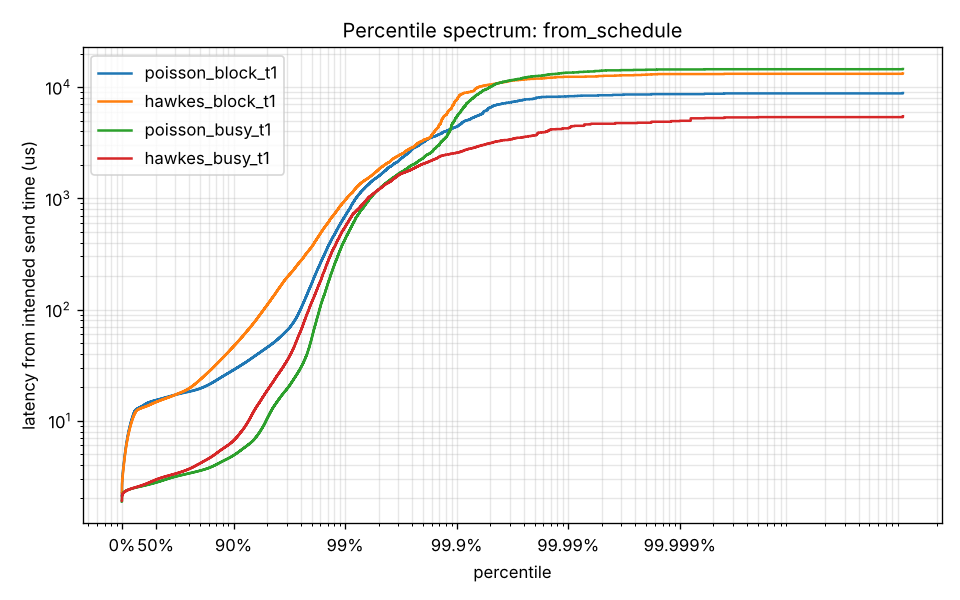
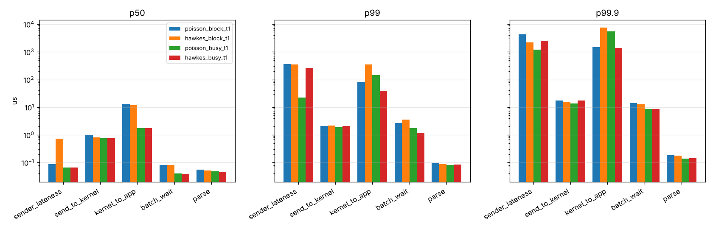
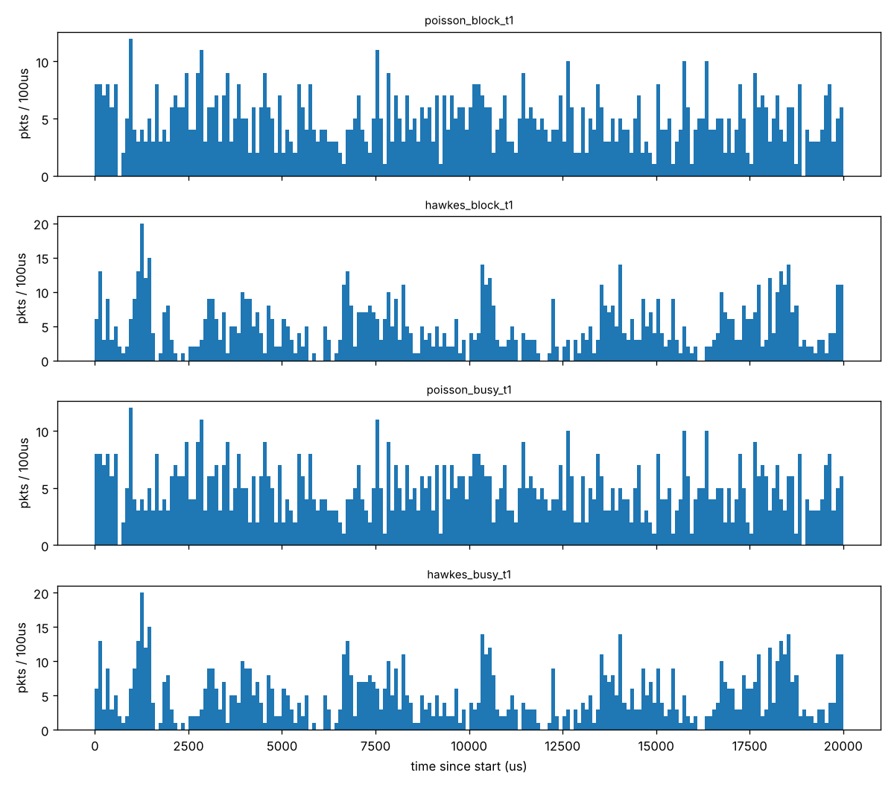

# TailTrace

**Why was this one packet slow? A tail-latency forensics toolkit for market-data style UDP feeds on Linux.**

TailTrace sends a Nasdaq ITCH 5.0 / MoldUDP64 style multicast feed between two network namespaces. Packet times follow a precomputed Poisson or Hawkes (self-exciting, bursty) schedule. The receiver splits every packet's latency into stages using kernel receive timestamps. This is **v0.1**: the testbed, the generator, the kernel-UDP receiver, fault injection and the measurement pipeline. io_uring, AF_XDP and eBPF tracing come next (see the roadmap below).

 

## What one packet's latency is made of

```
 sched ──► send ──────► kernel ─────────► app ───────► p0 ──────► p1
   │ sender   │ send_to_    │ kernel_to_    │ batch_     │ parse
   │ lateness │ kernel      │ app           │ wait       │
   └──────────┴─────────────┴───────────────┴────────────┘
   end_to_end  = p1 - send    (what most benchmarks report)
   from_schedule = p1 - sched (the honest number: includes the sender falling behind)
```

| Stage | From → to | What lives there |
|---|---|---|
| `sender_lateness` | intended send → `send()` | generator falling behind during bursts or when the VM stalls |
| `send_to_kernel` | `send()` → kernel RX timestamp | UDP/IP send path, veth, qdisc, softirq |
| `kernel_to_app` | kernel RX → `recvmmsg()` returns | waiting in the socket queue, scheduler wakeup |
| `batch_wait` | batch returned → this packet's parse starts | queueing behind earlier packets of the same batch |
| `parse` | parse start → end | ITCH decoding (the "application") |

## First results (v0.1, 4-vCPU cloud VM, 50k packets/s, 10 s per run, 3 seeds)

| | Poisson, blocking | Hawkes, blocking | Poisson, busy-poll | Hawkes, busy-poll |
|---|---|---|---|---|
| Burstiness: dispersion of counts over 1 ms windows | 1.0 | **9.2 to 9.6** | 1.0 | 9.2 to 9.6 |
| Busiest 100 µs | 16 to 18 pkts | **41 to 45 pkts** | 16 to 18 | 41 to 45 |
| `from_schedule` p50 | 13.5 to 15.7 µs | 14.7 to 15.2 µs | **2.7 to 2.8 µs** | 2.9 to 3.1 µs |
| `kernel_to_app` p50 | 11.9 to 13.0 µs | 11.8 to 12.0 µs | **1.7 to 1.8 µs** | 1.8 µs |
| `sender_lateness` p50 | 0.1 µs | **0.7 to 0.8 µs** | 0.1 µs | 0.1 µs |
| `from_schedule` p99.9 | 2.8 to 4.4 ms | 2.3 to 7.7 ms | 2.4 to 5.5 ms | 2.6 to 15.5 ms |

What this shows so far:

* **Busy-polling removes about 10 µs from the median.** That is the cost of the receiver thread sleeping and being woken up by the scheduler.
* **Bursts are visible below the far tail.** At the same mean rate, Hawkes traffic makes the blocking sender fall behind at the median (0.7 µs vs 0.1 µs), and its percentile curve sits above Poisson from p50 to p99.
* **On a cloud VM, millisecond stalls dominate p99.9 and above**, and they move between trials by up to 6x. The slowest 0.1% of packets were not preceded by more traffic than usual (about 5 to 10 packets in the previous 100 µs, the same as the average packet). They did come out of bigger `recvmmsg` batches (a mean of 3 to 32 packets, against 1.3 to 2.6 overall). That pattern means the whole guest paused and then drained what had piled up. That is a finding about the testbed, not about Poisson vs Hawkes. Getting clean tails needs a bare-metal Linux machine with isolated cores. Attributing a stall to its cause needs the eBPF tracer (milestone 7-8).
* **Fault injection is exact.** 0.1% loss, 0.1% duplicates and 0.1% reorders were all detected by sequence tracking, with counts that match what was injected one for one (the CI smoke test asserts this).





The full per-trial table is in [`results/report_all/summary.md`](results/report_all/summary.md).

## Quick start

Linux only, root needed for namespaces.

```bash
pip install -r requirements.txt
cmake -S . -B build -DCMAKE_BUILD_TYPE=Release
cmake --build build -j
ctest --test-dir build --output-on-failure

sudo scripts/testbed.sh up                  # two namespaces + veth pair
sudo scripts/run_experiment.sh demo \
     --gen  "--arrivals hawkes --rate 50000 --duration 5" \
     --recv "--mode busy --trace-every 1"
python3 analysis/report.py results/demo --out results/demo_report

sudo scripts/run_matrix.sh 50000 10 3       # the full experiment above
sudo scripts/netem.sh set delay 50us 10us   # kernel impairment, if sch_netem is available
sudo scripts/testbed.sh down
```

Useful flags:

| Tool | Flag | Meaning |
|---|---|---|
| `tt_gen` | `--arrivals poisson\|hawkes` `--rate` `--duration` `--seed` | schedule |
| | `--branching 0.7 --decay-us 50` | Hawkes shape: children per event, how long excitement lasts |
| | `--msgs-per-pkt N` | ITCH messages per UDP packet |
| | `--loss p --dup p --reorder p` | seeded fault injection |
| `tt_recv` | `--mode block\|busy` | sleep in `recvmmsg` or spin with `MSG_DONTWAIT` |
| | `--batch N` | packets per `recvmmsg` call |
| | `--rcvbuf BYTES` | socket receive queue size |
| | `--trace-every N` | write every Nth packet's timestamps to `trace.csv` |
| both | `--cpu N` | pin to a core |

## Repository layout

```
include/tt/  wire.hpp (ITCH 5.0 + MoldUDP64)  histogram.hpp (log-linear, HdrHistogram style)
             arrivals.hpp (Poisson, Hawkes via Ogata thinning)  seq_tracker.hpp (gaps, late, dups)
             rx_kernel_udp.hpp (receiver I/O layer A)  sys.hpp (clocks, pinning, args)
src/         tt_gen.cpp  tt_recv.cpp
scripts/     testbed.sh  netem.sh  env.sh  run_experiment.sh  run_matrix.sh
analysis/    report.py
tests/       test_wire  test_histogram  test_seq  test_arrivals
results/     per-run summaries, histograms and plots (per-packet traces are git-ignored)
```

Every results directory holds `env.txt` (kernel, CPU, governor, clocksource, netem), `cmd.txt`, `summary.csv` (all stages), `hist_*.csv` (full histograms), `recv_stats.csv` and `gen_stats.csv`.

## Roadmap

| Weeks | Deliverable | Status |
|---|---|---|
| 1-2 | Testbed, Poisson generator, kernel UDP receiver, latency histograms | **done** |
| 3-4 | Hawkes generator, sequence gap detection, `SO_TIMESTAMPING` | **done** |
| 5-6 | io_uring and AF_XDP receivers behind the same `RxBatch` interface | next |
| 7-8 | eBPF tracer (`netif_receive_skb`, `napi_poll`, `sched_switch`), per-batch attribution | |
| 9-10 | Record and replay, retransmit-request recovery path, netem vs in-generator faults | |
| 11-12 | Attribution engine, HTML report, methodology write-up | |

## Limitations

* veth is not a NIC: there is no hardware queue, no interrupt coalescing and no DMA. Results are relative comparisons and methodology, not hardware numbers.
* The kernel timestamp is a software one, taken as the packet enters the receive path. Without a PTP-capable NIC there is no wire timestamp.
* All stages use `CLOCK_REALTIME`, because that is what kernel software timestamps use. Both namespaces share the clock, so one-way latency is valid, but an NTP step during a run would corrupt it. Negative latencies are counted separately, never hidden.
